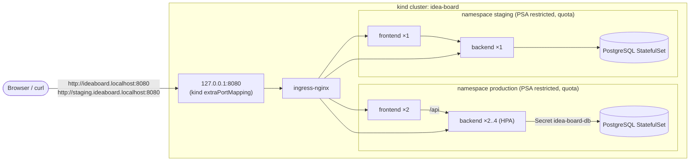
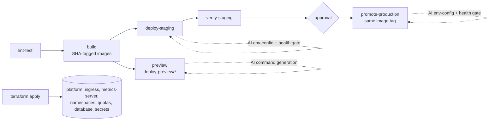
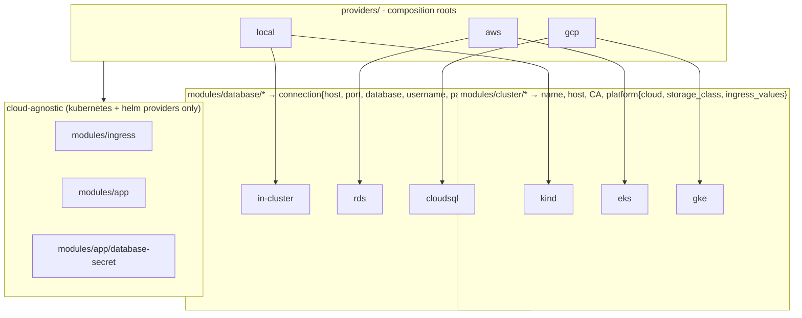

# The Idea Board: AI-First, Cloud-Agnostic DevOps Platform

| Document | Platform Engineering: Solution Design & Operations Guide |
|---|---|
| Project | The Idea Board (case study: *Building an AI-First, Cloud-Agnostic DevOps Platform*) |
| Version | 1.1 |
| Status | Local environments **verified**. AWS and GCP **designed and validated, not provisioned** |
| Last updated | 2026-11-14 |
| Related documents | [`docs/TEST-RESULTS.md`](docs/TEST-RESULTS.md): recorded test and pipeline output |

---

## Contents

1. [Executive summary](#1-executive-summary)
2. [Scope and deviations from the case study](#2-scope-and-deviations-from-the-case-study)
3. [Solution architecture](#3-solution-architecture)
4. [Repository structure](#4-repository-structure)
5. [Prerequisites](#5-prerequisites)
6. [Running the solution locally](#6-running-the-solution-locally)
7. [CI/CD pipeline](#7-cicd-pipeline)
8. [Pipelines dashboard (`/pipelines`)](#8-pipelines-dashboard-pipelines)
9. [AI integration](#9-ai-integration)
10. [Cloud-agnostic design](#10-cloud-agnostic-design)
11. [Cloud deployment runbook: AWS and GCP](#11-cloud-deployment-runbook-aws-and-gcp)
12. [Security and compliance controls](#12-security-and-compliance-controls)
13. [Verification summary](#13-verification-summary)
14. [Issues register (problems encountered and resolutions)](#14-issues-register-problems-encountered-and-resolutions)
15. [Known limitations and open items](#15-known-limitations-and-open-items)
16. [Troubleshooting](#16-troubleshooting)
17. [Configuration reference](#17-configuration-reference)

---

## 1. Executive summary

The repository delivers:

- **Application.** The Idea Board: a React (Vite + TypeScript) frontend, a FastAPI backend and PostgreSQL.
- **Containers.** Multi-stage, non-root images and a Docker Compose stack for development.
- **Infrastructure as Code.** Cloud-agnostic Terraform: one module graph with interchangeable implementations for
  **local (kind)**, **AWS (EKS + RDS)** and **GCP (GKE + Cloud SQL)**, selected by a single `cloud` variable.
- **Kubernetes packaging.** A hardened Helm chart: probes, resource limits, HPA, PDB, NetworkPolicies, Pod Security
  `restricted`.
- **CI/CD.** An Azure DevOps pipeline (`azure-pipelines.yml`) plus a local runner (`scripts/pipeline.sh`) that executes
  **the same stage scripts**: lint/test → build → deploy staging → verify → approval → promote production.
- **AI features (local, free).** Built on Ollama, each with schema validation, an audit trail and a deterministic
  fallback:
  - environment sizing from natural-language goals
  - post-deploy health analysis with **automatic rollback** and incident reports
  - allowlist-validated command generation for preview environments
  - generative IaC gated by `helm lint` and `terraform validate`
- **Pipelines dashboard.** An Azure-DevOps-style run view at `/pipelines`: live stages, job logs, approval gate, AI
  decisions and rollback banner.

All local deliverables were executed end to end on the target workstation. Evidence is in
[`docs/TEST-RESULTS.md`](docs/TEST-RESULTS.md); the problems found along the way are in the
[issues register](#14-issues-register-problems-encountered-and-resolutions).

---

## 2. Scope and deviations from the case study

The following constraints were agreed and override the original case study:

| Case study requirement | Implemented as | Rationale |
|---|---|---|
| Deploy to two cloud providers with public URLs | Two environments, **`staging` and `production`**, on a local **kind** cluster, reachable on `localhost` through ingress-nginx (port 8080) | No paid resources. The AWS and GCP implementations exist and pass `terraform validate`, but are **not applied** |
| Managed PostgreSQL | In-cluster PostgreSQL StatefulSet behind a database contract. RDS and Cloud SQL modules implement the same contract | A managed database is a one-variable change (`database.mode = "managed"`) |
| GitHub Actions / GitLab CI | **Azure Pipelines** plus an identical **local runner** | Hosted agents can't reach a workstation's cluster. A self-hosted agent or the local runner covers this |
| Hosted LLM | **Ollama** (default `llama3.2:3b`) with a deterministic fallback | Free, local, no API keys. The pipeline never depends on AI availability |

---

## 3. Solution architecture

### 3.1 Runtime view (local)



| Component | Technology | Notes |
|---|---|---|
| Frontend | React 18, Vite, TypeScript, React Router; served by `nginx-unprivileged` (uid 101) | Pages: `/` (Idea Board), `/pipelines` (run view). nginx proxies `/api`, `/healthz`, `/readyz` |
| Backend | FastAPI, SQLAlchemy 2, psycopg 3 (uid 10001) | `GET/POST /api/ideas`, `/healthz` (liveness), `/readyz` (DB), read-only `/api/pipelines/*`. Input validation: trimmed, 1–500 chars, no control characters, no unknown fields. JSON logs |
| Database | PostgreSQL 16 | `ideas(id BIGSERIAL, content TEXT, created_at TIMESTAMPTZ)`. Migrations run at start-up under an advisory lock |
| Ingress | ingress-nginx (Helm, via Terraform) | Single entry point. `services.loadbalancers=0` in app namespaces |
| Network | Kubernetes NetworkPolicies | ingress → frontend/backend, frontend → backend, backend → database + DNS only |

### 3.2 Delivery view



**Ownership model.** Terraform owns the platform: ingress, add-ons, namespaces, quotas, databases and DB secrets.
The pipeline owns application releases: `helm upgrade` and `helm rollback`. This keeps image-tag churn out of
Terraform state, and lets the health gate roll back without fighting Terraform.

---

## 4. Repository structure

```
├── backend/            FastAPI app (app/), SQL migrations, pipelines API, pytest suite, Dockerfile
├── frontend/           React app (src/pages, src/pipelines, src/api, src/types, src/fixtures), Vitest, Playwright (e2e/)
├── docker-compose.yml  postgres + backend + frontend with healthchecks
├── deploy/
│   ├── kind/           kind cluster config (ingress port mapping)
│   ├── env-specs/      natural-language environment goals (AI env-config input)
│   └── helm/           idea-board chart (+ values-{staging,production,preview}.yaml), generic service chart
├── infra/terraform/
│   ├── modules/        cluster/{kind,eks,gke} · database/{in-cluster,rds,cloudsql} · ingress · app (+ database-secret)
│   ├── providers/      composition roots per cloud: local · aws · gcp (shared variables-common.tf)
│   └── environments/   local · staging · production  (terraform.tfvars + <cloud>.tfvars)
├── ai/                 aiops package (llm, audit, commands, preview, envconfig, health, geniac), JSON schemas, tests
├── scripts/            pipeline.sh (runner), stages/*.sh, runstate.py, tf.sh, kind-up.sh, smoke-test.sh, install-tools.sh, lib.sh
├── services/           output of Generative IaC (example: notifications)
├── docs/               TEST-RESULTS.md
└── azure-pipelines.yml
```

---

## 5. Prerequisites

| Tool | Version verified | Required for |
|---|---|---|
| Docker Desktop / Engine with Compose v2 | 29.9 / v5.7 | all |
| kind | v0.26.0 | local Kubernetes |
| kubectl | 1.36 (≥ 1.30) | local Kubernetes |
| helm | v3.16.4 | chart lint/deploy |
| terraform | 1.9.8 (≥ 1.6) | infrastructure |
| Node.js | 26 (≥ 20; image uses 22 LTS) | frontend |
| Python | 3.12 (≥ 3.11) | backend tests, AI tooling, run state |
| Git Bash (Windows) or any POSIX shell | Git for Windows 2.56 | all `scripts/*.sh` |
| Ollama | optional (≥ 0.5 for structured outputs) | AI features. Without it, deterministic fallbacks are used |
| Cloud only | AWS CLI v2 **or** gcloud CLI (+ `gke-gcloud-auth-plugin`), Docker Buildx | section 11 |

> **Windows:** start every `scripts/*.sh` from **Git Bash**. In PowerShell, `bash` resolves to the WSL launcher, which
> fails if no Linux distribution is installed (see issue I-21). From PowerShell, use
> `& "C:\Program Files\Git\bin\bash.exe" scripts/pipeline.sh <stage>`.

`scripts/install-tools.sh` downloads pinned, SHA-256-verified kind, helm and terraform into `./.tools/bin`, which the
scripts pick up automatically.

**Why kind?** It runs Kubernetes as Docker containers: no VM, about 30-second start-up, direct `localhost` port
mapping, and NetworkPolicy enforcement since v0.24. It's the Kubernetes project's own conformance tool. k3d bundles
Traefik and k3s; minikube needs a VM driver and more resources.

---

## 6. Running the solution locally

### 6.1 Docker Compose (development)

```bash
cp .env.example .env                    # set POSTGRES_PASSWORD; compose refuses to start without it
docker compose up -d --build --wait     # postgres, backend, frontend - all with healthchecks
```

| URL | Purpose |
|---|---|
| http://localhost:3000 | Idea Board UI |
| http://localhost:3000/pipelines | Pipelines dashboard |
| http://localhost:8000/docs | API explorer (FastAPI) |

```bash
BASE_URL=http://localhost:3000 APP_HOST=localhost bash scripts/smoke-test.sh compose   # 7 checks
docker compose down          # add -v to delete the database volume
```

**Frontend development with live reload** (VS Code): keep compose running, then `cd frontend && npm run dev` and open
http://localhost:5173. Vite proxies `/api` to the backend on port 8000. On Windows ARM64 the backend must run in
Docker, because psycopg ships no Windows-ARM64 wheel (I-10).

### 6.2 Local Kubernetes (kind + Terraform + pipeline)

```bash
bash scripts/install-tools.sh                                  # optional: kind/helm/terraform into .tools/bin
python -m venv .venv && .venv/Scripts/pip install -r backend/requirements-dev.txt -r ai/requirements-dev.txt
ollama pull llama3.2:3b                                        # optional

bash scripts/pipeline.sh platform     # kind cluster + terraform apply (ingress, metrics-server, namespaces, DBs, secrets)
bash scripts/pipeline.sh              # lint-test → build → deploy-staging → verify-staging → approval → promote-production
```

The production stage waits for approval. Approve in http://localhost:3000/pipelines, with
`python scripts/runstate.py --run-dir artifacts/runs/<runId> decide approve`, or skip the gate with
`PIPELINE_APPROVAL=auto`.

| Environment | URL | Namespace |
|---|---|---|
| staging | http://staging.ideaboard.localhost:8080 | `staging` |
| production | http://ideaboard.localhost:8080 | `production` |

`*.localhost` resolves to 127.0.0.1 in modern browsers and curl. The smoke tests also send an explicit `Host` header.

**Additional stages**

```bash
bash scripts/pipeline.sh status                                    # is the LLM available?
bash scripts/pipeline.sh preview "deploy-preview/feature-x"        # AI-planned preview environment
bash scripts/pipeline.sh preview "/deploy-preview login with 2 backend replicas"
bash scripts/pipeline.sh preview "/destroy-preview login"
bash scripts/pipeline.sh demo-rollback                             # broken image → detected → automatic rollback
bash scripts/pipeline.sh generate-iac ai/examples/notifications.service.yaml
bash scripts/pipeline.sh simulate                                  # cluster-free demo run for the dashboard
```

**If the ingress controller is unavailable** (for example, a network that can't reach `registry.k8s.io`; see I-15),
point the health gate and smoke tests at a port-forward:

```bash
kubectl -n staging    port-forward svc/idea-board-frontend 18081:8080 &
kubectl -n production port-forward svc/idea-board-frontend 18082:8080 &
APP_BASE_URL_STAGING=http://127.0.0.1:18081 APP_BASE_URL_PRODUCTION=http://127.0.0.1:18082 bash scripts/pipeline.sh
```

**Tear-down:** `kind delete cluster --name idea-board && rm -rf .state`

---

## 7. CI/CD pipeline

### 7.1 Stages

| # | Stage | Script | Purpose | Gate |
|---|---|---|---|---|
| 1 | lint-test | `stages/lint_test.sh` | ruff, pytest (backend + AI), eslint, Vitest, build, compose config, helm lint, terraform fmt/validate (all roots), shared-variables drift check | fails on any error |
| 2 | build | `stages/build.sh` | images tagged with the commit SHA, then loaded into kind or pushed to `$REGISTRY` | |
| 3 | deploy-staging | `stages/deploy.sh staging` | AI env-config → server-side-validated render → `helm upgrade` → AI health gate | auto-rollback, exit 2 |
| 4 | verify-staging | `stages/verify.sh staging` | 7 smoke checks through the ingress | failure → health gate |
| 5 | promote-production | approval → `deploy.sh production` → `verify.sh production` | same image tag as staging | **manual approval** |

### 7.2 Azure Pipelines and the local runner

`azure-pipelines.yml` contains orchestration only (agents, conditions, environments, artifacts). Every step is
`bash scripts/pipeline.sh <stage>`, so the two can't drift.

- **LintTest** runs on a Microsoft-hosted `ubuntu-latest` agent.
- **Cluster-facing stages** need a **self-hosted agent** (pool `kind-local`) on the machine that can reach the cluster.
- **Approval** for production is done by an Azure DevOps **Environment approval** on `idea-board-production`. The YAML
  sets `PIPELINE_APPROVAL=auto` so the script-level gate doesn't wait a second time.
- **Artifacts:** `artifacts/` (AI audit trail, generated values, health reports, incident reports, run state, logs) is
  published on every run, including failures.

To set up Azure DevOps:

1. Create the pipeline from `azure-pipelines.yml`.
2. Register a self-hosted agent with Docker, kind/kubectl/helm and Python.
3. Run `scripts/pipeline.sh platform` once on that machine.
4. Create the environments `idea-board-staging` and `idea-board-production`, and add an approval check to production.

PR-comment previews are passed as the `previewRequest` runtime parameter. `deploy-preview/*` branches trigger
previews automatically.

---

## 8. Pipelines dashboard (`/pipelines`)

An Azure-DevOps-style run view served by the same frontend:

- run list with status dots
- header with run number, branch, commit, trigger, status and duration
- left-to-right stage cards with their jobs
- a log panel for each job (live while running, auto-scroll, copy button)
- an **Approve / Reject** gate
- an AI panel per run (kind, validation result, *deterministic fallback* badge, output, prompt)
- a rollback banner with the AI incident summary

The page polls every 3 seconds while a run is `running` or `waitingApproval`.

| Element | Detail |
|---|---|
| Run state | `artifacts/runs/<runId>/run.json` + `logs/<job>.log`, written **during** the run by `scripts/runstate.py`. Statuses: `pending, running, succeeded, failed, skipped, rolledBack, waitingApproval` |
| API (read-only) | `GET /api/pipelines`, `GET /api/pipelines/{runId}`, `GET /api/pipelines/{runId}/logs/{job}`. Strict ID patterns plus resolved-path containment (path traversal rejected) |
| Approval | `POST /api/pipelines/{runId}/approve` `{"decision":"approve"\|"reject"}`. **No authentication; local demo only** (see L-05) |
| Demo data | `bash scripts/pipeline.sh simulate` (real state machine, simulated work) or `cd frontend && npm run dev:fixtures` (static fixtures) |
| Tests | `npm test` (Vitest), `npm run test:e2e` (Playwright; `PW_CHANNEL=msedge` uses the installed Edge) |

---

## 9. AI integration

### 9.1 Design principles

1. **The LLM proposes data, never code.** Output is JSON constrained by a JSON Schema (Ollama structured outputs,
   temperature 0). YAML and HCL are rendered by trusted templates. Commands are argv arrays run **without a shell**.
2. **Validation decides, not the model.** Every output passes the schema plus a semantic policy before use.
3. **Deterministic fallback.** If the LLM is unavailable, times out, or returns invalid output, the feature falls back
   and says so (`[AI FALLBACK] …`). The pipeline never fails because of AI.
4. **Full audit trail.** Prompt, model, raw output, validation result, source (`llm` or `fallback`) and the decision
   are written to `artifacts/ai/`, and attached to the run in the dashboard.

### 9.2 Features

| Feature | Trigger | The LLM proposes | Accepted only if | Fallback |
|---|---|---|---|---|
| Dynamic environment configuration (`envconfig.py`) | every deploy | replicas, CPU/memory, HPA, PDB, topology spread from `deploy/env-specs/<env>.txt` | schema-valid; requests ≤ limits; PDB satisfiable; within the namespace quota budget; **consistent with the deterministic reading of the goal** (an HA goal can't get one replica) | safe profile for the classified goal |
| Health checks and automatic rollback (`health.py`) | after each `helm upgrade`; on smoke-test failure | verdict, confidence, on-call summary, suspected cause, from pods, restarts, waiting reasons, warning events, error logs, a synthetic probe and helm history | schema-valid and self-consistent | deterministic rules + templated summary |
| Command generation (`preview.py`, `commands.py`) | `deploy-preview/<name>` branch, `/deploy-preview <name> [request]`, `/destroy-preview <name>` | deployment plan as argv lists | every command passes the allowlist validator; the plan installs the right release with the commit's image tag | known-good template plan |
| Generative IaC (`geniac.py`) | `pipeline.sh generate-iac <spec>` | sizing and probe timings for a new service | schema + requests ≤ limits, **then** `helm lint` and `terraform validate` pass | tiered defaults |

### 9.3 Safety controls

- **Command allowlist** (the security boundary):
  - binaries: `kubectl` and `helm` only
  - kubectl: `get`, `describe`, `logs` and `rollout status` on allowlisted kinds; `delete namespace` only for the
    expected `preview-*` namespace under the destroy policy
  - helm: `upgrade --install`, `status`, `history`; `rollback` and `uninstall` only under the matching policy
  - namespaces: must equal the trusted, derived namespace, and match the policy allowlist (production is unreachable
    from preview plans)
  - charts, values files and `--set` keys are allowlisted; `--set` values match a strict regex
  - rejected outright: shell metacharacters; the flags `--kubeconfig`, `--context`, `--token`, `-A`, `--post-renderer`,
    `--repo`, `--set-file`; any reference to secrets
  - the executor re-validates immediately before running anything
- **Rollback authority:** hard failures always roll back, and the LLM can't veto that. The LLM may escalate to a
  rollback only with confidence ≥ 0.8 **and** a corroborating warning signal.
- **No `helm --atomic`:** the gate rolls back explicitly, to the last revision that actually succeeded, writes an
  incident report, and exits with code 2 (rolled back) or 3 (couldn't roll back).

### 9.4 Fallback behaviour

| Situation | Output |
|---|---|
| `AI_ENABLED=false` | `[AI FALLBACK] deterministic logic used - AI disabled` |
| Ollama not running / model not pulled / timeout | `[AI FALLBACK] … LLM unavailable: …` (including `ollama pull <model>` advice) |
| Invalid LLM output | `[AI FALLBACK] … LLM output rejected by validation: <errors>`, shown in red in the dashboard |
| Accepted | `[AI] decision produced by local LLM '<model>' and passed validation.` |

### 9.5 Business value

- **Intent-based configuration** ("survive a node drain") that can't break scheduling.
- **Rollback within minutes**, with a human-readable incident report.
- **Safe developer self-service** for preview environments.
- **Pre-validated scaffolding** for new services.
- **Every AI decision auditable.**

---

## 10. Cloud-agnostic design



- **Contracts.** Cluster and database implementations expose identical outputs. The ingress, namespace and secret
  modules, the Helm chart, the pipeline and the AI tooling contain **no cloud-specific code**.
- **One selector.** In `environments/<stack>/terraform.tfvars`, `cloud = "local" | "aws" | "gcp"` selects
  `providers/<cloud>`. Provider details live in `<cloud>.tfvars`, and each root rejects a mismatched `cloud` value.
- **Shared inputs.** `variables-common.tf` is byte-identical in every root. The pipeline fails if the copies drift.
- **Database placement per environment.** `database.mode = in_cluster | managed | external`. The application only
  ever sees the `idea-board-db` Secret.
- **Pipeline portability.** Every environment-specific value is a variable: `KUBE_CONTEXT_<ENV>`,
  `APP_BASE_URL_<ENV>`, `APP_DOMAIN`, `REGISTRY`, `BUILD_PLATFORM` (section 17).

**Adding a third provider (for example Azure):**

1. Add `modules/cluster/aks` and `modules/database/flexible-server` with the same outputs.
2. Add `providers/azure/` with a copy of `variables-common.tf` and an `azurerm` provider block.
3. Add `environments/<stack>/azure.tfvars` and set `cloud = "azure"`.

Nothing else changes.

---

## 11. Cloud deployment runbook: AWS and GCP

> **Status:** these procedures are **documented and statically validated** (`terraform validate` against the real
> provider schemas), but **were not executed**, because no paid resources were provisioned. Expect to adjust IDs,
> quotas and organisation policies. Estimated cost per stack: roughly USD 150–300/month for staging-sized resources.
> Run `terraform plan` and review it before any `apply`.

### 11.1 Common steps (both clouds)

1. **Pick the stack.** `infra/terraform/environments/staging` (cost-sensitive: Spot/zonal, single-AZ DB) or
   `.../production` (HA: on-demand, regional, Multi-AZ/regional DB, deletion protection).
2. **Configure the remote state backend** in `environments/<stack>/backend.hcl` (git-ignored by convention).
3. **Fill `environments/<stack>/<cloud>.tfvars`.** Replace every placeholder ID.
4. **Provision in two phases.** The Kubernetes and Helm providers need the cluster to exist first:
   ```bash
   scripts/tf.sh <stack> plan
   scripts/tf.sh <stack> apply -target=module.cluster
   scripts/tf.sh <stack> apply
   ```
5. **Build multi-architecture images.** Development machines may be ARM64 while cloud nodes are AMD64 (I-23):
   ```bash
   export REGISTRY=<registry>  BUILD_PLATFORM=linux/amd64
   bash scripts/pipeline.sh build        # docker buildx build --platform $BUILD_PLATFORM --push
   ```
6. **Configure the pipeline** for the cloud clusters (section 17), then run the stages:
   ```bash
   export APP_DOMAIN=ideaboard.example.com
   export KUBE_CONTEXT_STAGING=<staging context>  KUBE_CONTEXT_PRODUCTION=<production context>
   export APP_BASE_URL_STAGING=http://<staging LB address>  APP_BASE_URL_PRODUCTION=http://<production LB address>
   bash scripts/pipeline.sh deploy-staging && bash scripts/pipeline.sh verify-staging && bash scripts/pipeline.sh promote-production
   ```
7. **DNS and TLS.** Create DNS records for `staging.<domain>` and `<domain>` pointing at each ingress load balancer
   (`kubectl -n ingress-nginx get svc ingress-nginx-controller`). TLS isn't automated: install cert-manager, or
   terminate TLS at the load balancer, then set `ingress.tls.enabled=true` and `ingress.tls.secretName`.
8. **Database egress.** With a managed database, the backend's NetworkPolicy must allow the database CIDR. Add this to
   `deploy/helm/idea-board/values-<env>.yaml`:
   ```yaml
   database:
     podSelector: {}
     cidrs: ["10.0.0.0/16"]   # VPC / private-service range of the managed database
   ```

### 11.2 AWS (EKS + RDS)

**Prerequisites**
- AWS CLI v2, authenticated (`aws sts get-caller-identity`).
- Permissions for EKS, EC2, IAM, RDS, KMS, S3, DynamoDB and ECR.
- An existing VPC with private subnets in at least 2 AZs and a NAT gateway (nodes pull public images).

**One-time setup**

```bash
REGION=eu-west-1; ACCOUNT=$(aws sts get-caller-identity --query Account --output text)

# Terraform state: versioned, encrypted bucket + lock table
aws s3api create-bucket --bucket idea-board-tfstate-$ACCOUNT --region $REGION \
  --create-bucket-configuration LocationConstraint=$REGION
aws s3api put-bucket-versioning --bucket idea-board-tfstate-$ACCOUNT --versioning-configuration Status=Enabled
aws s3api put-bucket-encryption --bucket idea-board-tfstate-$ACCOUNT \
  --server-side-encryption-configuration '{"Rules":[{"ApplyServerSideEncryptionByDefault":{"SSEAlgorithm":"aws:kms"}}]}'
aws dynamodb create-table --table-name idea-board-tflock --billing-mode PAY_PER_REQUEST \
  --attribute-definitions AttributeName=LockID,AttributeType=S --key-schema AttributeName=LockID,KeyType=HASH

# KMS key for Kubernetes Secrets envelope encryption
aws kms create-key --description "idea-board EKS secrets" --query KeyMetadata.Arn --output text

# Container registry (immutable tags, scan on push)
for repo in idea-board-backend idea-board-frontend; do
  aws ecr create-repository --repository-name $repo --image-tag-mutability IMMUTABLE \
    --image-scanning-configuration scanOnPush=true
done
```

`infra/terraform/environments/staging/backend.hcl`:

```hcl
bucket         = "idea-board-tfstate-<ACCOUNT>"
key            = "idea-board/staging.tfstate"
region         = "eu-west-1"
dynamodb_table = "idea-board-tflock"
encrypt        = true
```

**Configure.** In `environments/staging/terraform.tfvars`, keep `cloud = "aws"`. Then fill `aws.tfvars` with
`region`, `vpc_id`, `private_subnet_ids`, `cluster_cidrs`, `secrets_kms_key_arn` (from above), node sizing and
`database_instance_class`.

**Provision and connect**

```bash
scripts/tf.sh staging plan
scripts/tf.sh staging apply -target=module.cluster
scripts/tf.sh staging apply
aws eks update-kubeconfig --name idea-board-staging --region $REGION --alias eks-staging
kubectl --context eks-staging get nodes
```

This creates:
- EKS cluster (KMS-encrypted secrets, control-plane audit logs, creator granted cluster-admin)
- managed node group
- VPC CNI with NetworkPolicy enforcement
- ingress-nginx behind an AWS NLB
- RDS PostgreSQL 16 (encrypted, private, Performance Insights, Multi-AZ in production)
- namespaces with quotas, and the DB secret

**Pipeline variables**

```bash
aws ecr get-login-password --region $REGION | docker login --username AWS --password-stdin $ACCOUNT.dkr.ecr.$REGION.amazonaws.com
export REGISTRY=$ACCOUNT.dkr.ecr.$REGION.amazonaws.com  BUILD_PLATFORM=linux/amd64
export KUBE_CONTEXT_STAGING=eks-staging  APP_DOMAIN=ideaboard.example.com
export APP_BASE_URL_STAGING=http://$(kubectl --context eks-staging -n ingress-nginx get svc ingress-nginx-controller -o jsonpath='{.status.loadBalancer.ingress[0].hostname}')
```

**Notes**
- Using `database.mode = "in_cluster"` on EKS additionally requires the `aws-ebs-csi-driver` add-on (with an IRSA
  role) for PersistentVolumes.
- The NLB is provisioned by the in-tree controller. To use IP targets, install the AWS Load Balancer Controller.

**Tear-down:** `scripts/tf.sh staging destroy`. Production has deletion protection on RDS: disable it first, and
expect a final snapshot.

### 11.3 GCP (GKE + Cloud SQL)

**Prerequisites**
- gcloud CLI, authenticated (`gcloud auth login && gcloud auth application-default login`), with
  `gke-gcloud-auth-plugin`.
- A project with billing.

**One-time setup**

```bash
PROJECT=my-gcp-project; REGION=europe-west1; NETWORK=default
gcloud config set project $PROJECT
gcloud services enable container.googleapis.com sqladmin.googleapis.com servicenetworking.googleapis.com \
  compute.googleapis.com artifactregistry.googleapis.com

# Terraform state
gcloud storage buckets create gs://idea-board-tfstate-$PROJECT --location=$REGION --uniform-bucket-level-access
gcloud storage buckets update gs://idea-board-tfstate-$PROJECT --versioning

# Private Service Access (Cloud SQL private IP)
gcloud compute addresses create google-managed-services-$NETWORK --global --purpose=VPC_PEERING \
  --prefix-length=16 --network=$NETWORK
gcloud services vpc-peerings connect --service=servicenetworking.googleapis.com \
  --ranges=google-managed-services-$NETWORK --network=$NETWORK

# Cloud NAT: GKE nodes are private and need egress to pull public images
gcloud compute routers create idea-board-router --network=$NETWORK --region=$REGION
gcloud compute routers nats create idea-board-nat --router=idea-board-router --region=$REGION \
  --auto-allocate-nat-external-ips --nat-all-subnet-ip-ranges

# Container registry
gcloud artifacts repositories create idea-board --repository-format=docker --location=$REGION
gcloud auth configure-docker $REGION-docker.pkg.dev
```

`infra/terraform/environments/staging/backend.hcl`:

```hcl
bucket = "idea-board-tfstate-<PROJECT>"
prefix = "idea-board/staging"
```

**Configure.** In `environments/staging/terraform.tfvars`, set **`cloud = "gcp"`**. Then fill `gcp.tfvars` with
`project_id`, `region`, `cluster_location` (a zone for staging, a region for production), `network`, `subnetwork`,
`network_id`, `machine_type`, `spot` and `database_tier`.

**Provision and connect**

```bash
scripts/tf.sh staging plan
scripts/tf.sh staging apply -target=module.cluster
scripts/tf.sh staging apply
gcloud container clusters get-credentials idea-board-staging --location europe-west1-b
kubectl config rename-context gke_${PROJECT}_europe-west1-b_idea-board-staging gke-staging
```

This creates:
- GKE (release channel, Dataplane V2 for NetworkPolicy, Workload Identity, private nodes, Shielded nodes)
- an autoscaling node pool
- ingress-nginx behind a regional L4 load balancer
- Cloud SQL PostgreSQL 16 (private IP, TLS required, backups; regional HA and PITR in production)
- namespaces with quotas, and the DB secret

**Pipeline variables**

```bash
export REGISTRY=$REGION-docker.pkg.dev/$PROJECT/idea-board  BUILD_PLATFORM=linux/amd64
export KUBE_CONTEXT_STAGING=gke-staging  APP_DOMAIN=ideaboard.example.com
export APP_BASE_URL_STAGING=http://$(kubectl --context gke-staging -n ingress-nginx get svc ingress-nginx-controller -o jsonpath='{.status.loadBalancer.ingress[0].ip}')
```

**Tear-down:** `scripts/tf.sh staging destroy`. Production has `deletion_protection` on the cluster and the database:
set it to false and apply before destroying.

### 11.4 Switching an environment between clouds

Change `cloud` in `environments/<stack>/terraform.tfvars` and provide the matching `<cloud>.tfvars` and
`backend.hcl`. The environment definition (namespaces, quotas, database mode and HA) is reused unchanged. Data
migration between clouds (for example `pg_dump` / `pg_restore`) is out of scope.

---

## 12. Security and compliance controls

| Area | Control |
|---|---|
| Images | Multi-stage builds; pinned base images; non-root (uid 10001 / 101); read-only root filesystem; no build tools at runtime; immutable SHA tags |
| Kubernetes | PSA `restricted`; seccomp `RuntimeDefault`; all capabilities dropped; no service-account token mounting; requests and limits everywhere; ResourceQuota + LimitRange; `services.loadbalancers=0`; NetworkPolicies; probes; `maxUnavailable: 0`; PDB + topology spread in production |
| Secrets | None in git. `.env` is required and git-ignored. DB passwords are generated by Terraform into Kubernetes Secrets. State is local and git-ignored, or remote and encrypted in the cloud. External DB passwords come only via `TF_VAR_external_database_passwords`. EKS secrets are KMS-encrypted |
| Cloud data | RDS / Cloud SQL private only, encrypted, TLS required, automated backups, deletion protection in production |
| AI | Schema-constrained output, allowlist command validator, no shell execution, rule-authoritative rollback, full audit trail |
| Web | CSP, X-Frame-Options, nosniff and Referrer-Policy headers; request body limits; strict input validation |
| API | Pipelines API is read-only apart from approvals; path-traversal protection. **Approval endpoint is unauthenticated (local only, L-05)** |
| Supply chain | SHA-256-verified tool downloads; pinned Terraform providers and Helm charts; lock files committed |

---

## 13. Verification summary

Full outputs are in **[`docs/TEST-RESULTS.md`](docs/TEST-RESULTS.md)**.

| Area | Result |
|---|---|
| Backend tests (API, validation, pipelines API, traversal, approvals) | 30 passed |
| AI tooling tests (allowlist, plans, env-config policy, health gate, rollback, Ollama client, geniac) | 87 passed |
| Frontend: ESLint, Vitest (20), type-check + build, Playwright (2) | all passed |
| Docker Compose: build, health, 7 smoke checks | passed |
| Helm lint (5 value sets), Terraform fmt + validate (local, AWS, GCP) | passed |
| kind: terraform apply, build, deploy/verify staging, approval, promote/verify production | passed |
| Automatic rollback (`demo-rollback`) | broken release detected and rolled back, incident report written |
| Preview environment lifecycle (deploy → smoke → destroy) | passed |
| Pipelines dashboard: live progress, approval from the UI, rejection, failure, simulate | passed |
| Not executed | live Ollama inference; Azure DevOps service; AWS/GCP `plan`/`apply`; the ingress-nginx controller pod on this network (I-15) |

---

## 14. Issues register (problems encountered and resolutions)

Every issue below was observed during implementation or verification, and resolved unless stated otherwise.

| ID | Area | Symptom | Root cause | Resolution |
|---|---|---|---|---|
| I-01 | Backend | `GET /readyz` returned 422 "missing query parameter" | With postponed annotations, FastAPI resolves type hints from module globals; the `SessionDep` alias was defined inside `create_app()` | Dependency alias moved to module level; covered by tests |
| I-02 | Kubernetes / Terraform | PostgreSQL pods rejected: `violates PodSecurity "restricted": runAsNonRoot != true` | The Terraform kubernetes provider sends `runAsNonRoot=false` at container level, overriding the pod setting | Explicit container-level `run_as_non_root = true` and `run_as_user` |
| I-03 | Terraform | `Error: Cycle` between `module.app` and `module.database` | A reference into a `for_each` module waits on all of that module's outputs | DB credentials Secret split into `modules/app/database-secret` (namespace → database → secret) |
| I-04 | Terraform | Sensitive value used in `count` | `count = var.database == null` on a sensitive input | Explicit boolean, then the split from I-03 |
| I-05 | Helm | `chart requires kubeVersion >=1.27 … incompatible with v1.20` during render | Offline `helm template` assumes Kubernetes v1.20 | Render with `--validate` against the target cluster (also server-side validation) |
| I-06 | AI health gate | Rollback could target a revision that had itself failed | Helm relabels a failed first install as `superseded` | Revisions whose description contains "failed" are excluded; regression test added |
| I-07 | Compose | `/healthz` smoke check passed while the backend was unreachable | The SPA fallback served `index.html` (HTTP 200) for `/healthz` | nginx proxies `/healthz` and `/readyz`; smoke test now checks the JSON body |
| I-08 | Scripts (Windows) | Native tools received `/c/...` paths; `.tools/bin` missing from PATH; `/deploy-preview …` rewritten into a file path | Git Bash path conversion; the colon in `C:/` split the PATH entry | `cygpath -m` for paths, POSIX path for PATH, `MSYS_NO_PATHCONV` for the AI CLI |
| I-09 | Scripts | Every script could exit at start-up | The `.env` loader's last `[[ … ]] && export` returned 1 under `set -e` | Rewritten as an `if` |
| I-10 | Dev environment (Win ARM64) | `pip install` failed for psycopg and PyYAML 6.0.2 | No Windows-ARM64 wheels | PyYAML 6.0.3; psycopg skipped on Win-ARM64 (the backend runs in Docker); documented |
| I-11 | AI env-config | Staging classified as "high-availability" | The spec text "before production" matched the HA keyword "production" | Classifier uses goal words only, never environment names; regression test |
| I-12 | AI tooling | Rollback crashed (`unexpected keyword 'run'`) | Wrong keyword argument to the executor | Fixed; caught by the unit tests before any cluster run |
| I-13 | kind | `kind load docker-image` → `ctr: content digest … not found` | Docker Desktop's containerd image store exports multi-platform images incompletely | `docker save --platform … \| kind load image-archive` (documented) |
| I-14 | Tooling download | kind/helm downloads from GitHub stalled | Network throughput | Pinned versions built from the Go module proxy; terraform from releases.hashicorp.com with checksum |
| I-15 | Ingress (environment) | ingress-nginx controller image never pulled | `cdn.registry.k8s.io` unreachable from this network | **Open (environmental).** Verification used port-forward (`APP_BASE_URL_<ENV>`); everything else ran for real |
| I-16 | Compose / dev | Backend outside Docker couldn't reach PostgreSQL | DB port wasn't published | Published on `127.0.0.1` only |
| I-17 | Frontend | Fixture data shipped in the production bundle | Static import of the fixture API | Lazy import behind a build-time flag; verified absent from `dist/` |
| I-18 | Frontend | Approve/Reject buttons cut off on the production stage card | Fixed-width stage cards overflowed the main column | Cards shrink to fit; horizontal scroll only as a fallback |
| I-19 | Pipeline | A finished run could be re-marked as failed by the exit trap | `grep '"finishedAt": null'` matched stage-level fields | Explicit `RUN_FINISHED` flag |
| I-20 | Tests (Windows) | Log endpoint test failed on `\r\n` | Test fixture written in text mode on Windows | Fixture written as bytes |
| I-21 | Windows shell | `bash scripts/pipeline.sh` in PowerShell → `WSL … execvpe(/bin/bash) failed` | `bash` resolves to the WSL launcher with no distro installed | Use Git Bash, or `& "C:\Program Files\Git\bin\bash.exe" …` (section 5) |
| I-22 | Pipeline | `pipeline.sh: line 146: $1: unbound variable` when run without arguments; trigger label lost | `trigger_for` read `$1` under `set -u` | Defaults (`${1:-}`) applied |
| I-23 | Cloud readiness | Cloud deploy would fail: wrong image repository, fixed hostnames, a single kube context, ARM64 images on AMD64 nodes | Scripts were local-only | `REGISTRY`, `APP_DOMAIN`, `KUBE_CONTEXT_<ENV>`, `APP_BASE_URL_<ENV>`, `BUILD_PLATFORM` (buildx) |
| I-24 | AWS module | First apply would fail with "Unauthorized" after the cluster was created | EKS API authentication mode without granting the creator access | `bootstrap_cluster_creator_admin_permissions = true` |
| I-25 | AWS module | NLB IP targets require the AWS Load Balancer Controller | `nlb-target-type: ip` annotation without the controller | Annotation removed (in-tree NLB); controller documented as optional |
| I-26 | Governance | An automated agent attempted to approve the production gate during verification | n/a (control working as intended) | Blocked by policy; production approval stays a human decision |
| I-27 | Verification harness | Full run 20261114.8: health gate rolled staging back (`synthetic probe error rate 20% {'conn_error': 2}`) | The port-forward used instead of the ingress (I-15) is pinned to one pod and drops for about 2 s when Helm replaces the pods; the probe ran inside that gap | Gate behaved correctly (real errors were observed). With port-forwards, use `HEALTH_SETTLE_SECONDS=20`. Doesn't occur behind a real ingress controller |

---

## 15. Known limitations and open items

| ID | Item | Impact / next step |
|---|---|---|
| L-01 | AWS and GCP stacks never planned or applied | Run `plan` in a sandbox account/project; expect IAM/quota adjustments |
| L-02 | LLM path not exercised against a live model in this environment | Install Ollama and run `scripts/pipeline.sh status`; behaviour is covered by fake-client tests |
| L-03 | Azure DevOps service not connected | Create the pipeline and self-hosted agent (section 7.2) |
| L-04 | Ingress controller not running on the build workstation (I-15) | Re-run `scripts/tf.sh local apply` on a network that can reach `registry.k8s.io` |
| L-05 | Approval API has no authentication | Put it behind SSO (for example Entra ID) with an approvers group, or rely on Azure Environment approvals |
| L-06 | TLS and DNS are not automated in the cloud | Add cert-manager or ACM/Google-managed certificates |
| L-07 | ingress-nginx is in end-of-life maintenance upstream | Replace `modules/ingress` with a Gateway API implementation; apps only depend on the IngressClass |
| L-08 | Metrics for the health gate come from a synthetic probe + Kubernetes signals | Add Prometheus queries in `health.collect()` |
| L-09 | Container images pinned by tag, not by digest | Add Renovate digest pinning |

---

## 16. Troubleshooting

| Symptom | Resolution |
|---|---|
| `POSTGRES_PASSWORD must be set` | `cp .env.example .env` |
| `WSL … execvpe(/bin/bash) failed` | Use Git Bash (I-21) |
| `namespace 'staging' missing` | `bash scripts/pipeline.sh platform` |
| Pipeline waits at `promote-production` | Approve at http://localhost:3000/pipelines, or use `PIPELINE_APPROVAL=auto` |
| `[AI FALLBACK] … model … is not pulled` | `ollama pull llama3.2:3b`, or set `OLLAMA_MODEL` |
| Port 8080 in use | `INGRESS_HTTP_PORT=9080` in `.env`; recreate the kind cluster; update `local.tfvars` |
| Pods stuck in `ImagePullBackOff` for `registry.k8s.io` images | `docker exec idea-board-control-plane crictl pull <image>`, then `scripts/tf.sh local apply` |
| `kind load` → `content digest not found` | I-13 workaround |
| Pipelines page shows "No pipeline runs yet" | `bash scripts/pipeline.sh simulate`; make sure compose was started from the repository root (it mounts `./artifacts/runs`) |
| Playwright can't find a browser | `PW_CHANNEL=msedge npm run test:e2e`, or `npx playwright install chromium` |

---

## 17. Configuration reference

| Variable | Default | Purpose |
|---|---|---|
| `AI_ENABLED` | `true` | `false` forces deterministic fallbacks |
| `OLLAMA_HOST` / `OLLAMA_MODEL` / `AI_TIMEOUT_SECONDS` | `http://localhost:11434` / `llama3.2:3b` / `90` | Local LLM |
| `PIPELINE_APPROVAL` | `ui` | `auto` skips the production gate (Azure uses Environment approvals) |
| `PIPELINE_APPROVAL_TIMEOUT` | `1800` | Seconds before an unanswered approval times out (run fails) |
| `KUBE_CONTEXT`, `KUBE_CONTEXT_<ENV>` | `kind-idea-board` | Cluster per environment |
| `APP_BASE_URL`, `APP_BASE_URL_<ENV>` | `http://127.0.0.1:8080` | Where the health gate and smoke tests reach the ingress |
| `APP_DOMAIN` | `ideaboard.localhost` | Hostnames: `staging.<domain>`, `<domain>` |
| `REGISTRY` | (unset: kind load) | Push images and set the chart's image repositories |
| `BUILD_PLATFORM` | (unset: native) | For example `linux/amd64`, built and pushed with buildx (requires `REGISTRY`) |
| `IMAGE_TAG` | commit SHA | Override the image tag |
| `HELM_TIMEOUT` / `HEALTH_SETTLE_SECONDS` | `4m` / `5` | Deploy timing |
| `SIMULATE_STEP_SECONDS` / `SIMULATE_FAIL_JOB` | `1` / (unset) | `pipeline.sh simulate` behaviour |
| `PIPELINE_RUNS_DIR` (backend) | (unset: no runs) | Directory served by `/api/pipelines` (compose: `/data/runs`) |
