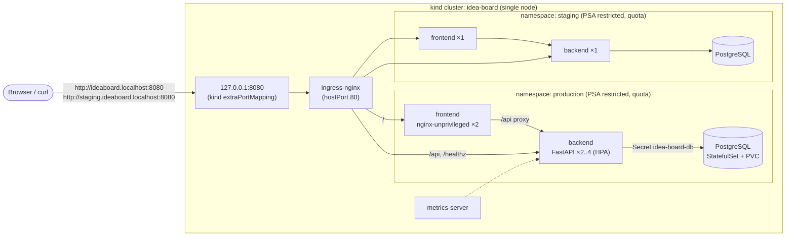
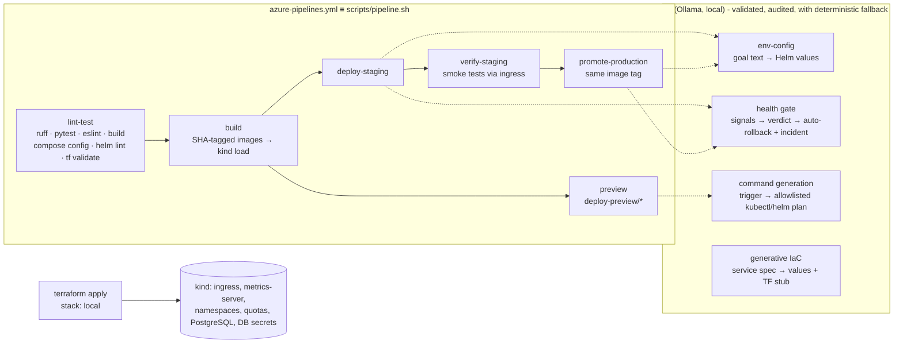
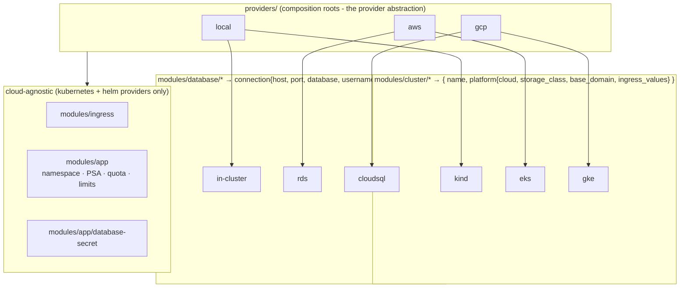

# The Idea Board: an AI-first, cloud-agnostic DevOps platform (local edition)

A small full-stack app (React → FastAPI → PostgreSQL) and the platform that ships it:
containers, cloud-agnostic Terraform, a hardened Helm chart, an Azure DevOps pipeline with
an identical local runner, and **AI features that run on a free, local LLM (Ollama)**. Every AI
feature falls back to deterministic logic when the LLM is missing.

> **Local-only edition.** This implements the case study *"Building an AI-First, Cloud-Agnostic
> DevOps Platform"* with these deliberate changes:
>
> | Case study asks for | This repo does | Why |
> |---|---|---|
> | Deploy to two cloud providers, public URLs | Deploys to **two environments (`staging`, `production`) on a local kind cluster**, reachable on `localhost` through ingress-nginx | No paid resources. The same Terraform module graph has AWS and GCP implementations that pass `terraform validate` but are **not applied** |
> | Managed PostgreSQL | In-cluster PostgreSQL StatefulSet behind a **database contract**; RDS / Cloud SQL modules implement the same contract | Swapping in a managed DB changes one variable |
> | GitHub Actions / GitLab CI | **Azure Pipelines** (`azure-pipelines.yml`) + **local runner** (`scripts/pipeline.sh`), both calling the same stage scripts | Azure-hosted agents can't reach a laptop's kind cluster |
> | An LLM | **Ollama** (default `llama3.2:3b`, configurable) | Free, local, no API keys |

---

## Contents

1. [Architecture](#1-architecture)
2. [Repository layout](#2-repository-layout)
3. [Prerequisites](#3-prerequisites)
4. [Run locally with Docker Compose](#4-run-locally-with-docker-compose)
5. [Run on local Kubernetes (kind + Terraform + pipeline)](#5-run-on-local-kubernetes-kind--terraform--pipeline)
   - [Pipelines page](#5a-pipelines-page-run-view-in-the-browser)
6. [CI/CD: Azure Pipelines and the local runner](#6-cicd-azure-pipelines-and-the-local-runner)
7. [AI Integration](#7-ai-integration)
8. [Cloud-Agnostic Approach](#8-cloud-agnostic-approach)
9. [Security and operational practices](#9-security-and-operational-practices)
10. [What was verified](#10-what-was-verified)
11. [Troubleshooting](#11-troubleshooting)

---

## 1. Architecture

### Runtime



* **Frontend:** Vite + React + TypeScript, built into static files and served by
  `nginx-unprivileged` (uid 101, read-only root FS). Its nginx also proxies `/api` so the same
  image works under docker-compose.
* **Backend:** FastAPI + SQLAlchemy 2 + psycopg 3. `GET/POST /api/ideas`, `/healthz`
  (liveness, no DB), `/readyz` (DB ping). It validates input (trimmed, non-empty, ≤ 500 chars, no control
  characters, no unknown fields) and writes JSON logs. SQL migrations run at start-up under a
  PostgreSQL advisory lock, so several replicas can start at once safely.
* **Database:** PostgreSQL 16 with `ideas(id BIGSERIAL, content TEXT, created_at TIMESTAMPTZ)`
  (`backend/app/migrations/001_create_ideas.sql`).
* **NetworkPolicies:** ingress-nginx → frontend/backend, frontend → backend, backend →
  PostgreSQL + DNS. The database accepts connections only from backend pods.

### Delivery



**Ownership split:** Terraform owns the *platform* (ingress, add-ons, namespaces, quotas, the
database and its credentials Secret). The pipeline owns *application releases*
(`helm upgrade` / `helm rollback`). Image tags change on every commit, so keeping releases out of
Terraform state avoids constant drift, and the AI health gate can roll back without fighting Terraform.

---

## 2. Repository layout

```
├── backend/                     FastAPI app, SQL migrations, pytest suite, multi-stage Dockerfile
├── frontend/                    Vite/React/TS app, ESLint, nginx template, multi-stage Dockerfile
├── docker-compose.yml           postgres + backend + frontend with healthchecks
├── deploy/
│   ├── kind/cluster.yaml        kind config (ingress port mapping)
│   ├── env-specs/*.txt          natural-language goals per environment (input to AI env-config)
│   └── helm/
│       ├── idea-board/          app chart + values.schema.json + values-{staging,production,preview}.yaml
│       └── service/             generic chart targeted by Generative IaC
├── infra/terraform/
│   ├── modules/
│   │   ├── cluster/{kind,eks,gke}            ─┐ same output contract: name, platform{...}
│   │   ├── database/{in-cluster,rds,cloudsql} ─┤ same output contract: connection{...}
│   │   ├── ingress/                           ─┤ cloud-agnostic (helm provider)
│   │   └── app/ (+ app/database-secret)       ─┘ cloud-agnostic (kubernetes provider)
│   ├── providers/{local,aws,gcp}/   composition roots = the provider abstraction
│   └── environments/{local,staging,production}/terraform.tfvars + <cloud>.tfvars
├── ai/
│   ├── aiops/                   llm · audit · commands (allowlist) · preview · envconfig · health · geniac · CLI
│   ├── schemas/                 JSON Schemas that constrain and validate every LLM output
│   ├── examples/                service spec for Generative IaC
│   └── tests/                   validator / fallback / health-gate tests
├── scripts/
│   ├── pipeline.sh              local runner (same stages as Azure)
│   ├── stages/*.sh              lint_test · build · deploy · verify · preview · generate_iac · platform
│   ├── tf.sh                    Terraform wrapper: picks providers/<cloud> from the stack's tfvars
│   ├── kind-up.sh · smoke-test.sh · install-tools.sh · lib.sh
├── azure-pipelines.yml
└── .env.example
```

---

## 3. Prerequisites

| Tool | Version used | Needed for |
|---|---|---|
| Docker (Desktop or Engine) + Compose v2 | 29.x / v2.30+ | everything |
| kind | v0.26.0 | local Kubernetes |
| kubectl | ≥ 1.30 | local Kubernetes |
| helm | v3.16.x | chart lint/deploy |
| terraform | ≥ 1.6 (1.9.8 used) | infrastructure |
| Node.js | 20+ (22 LTS in the image) | frontend dev / lint |
| Python | 3.11+ (3.12 used) | backend + AI tooling |
| Ollama | any recent (structured outputs need ≥ 0.5) | **optional**: AI features fall back without it |
| bash | Linux/macOS shell, or Git Bash on Windows | scripts |

`scripts/install-tools.sh` can fetch pinned, SHA-256-verified **kind, helm and terraform** into
`./.tools/bin` (git-ignored, picked up automatically by every script) if you'd rather not install
them system-wide.

**Why kind?** It runs Kubernetes nodes as Docker containers. You already have Docker, so kind
needs no VM or hypervisor. It's the upstream Kubernetes project's own conformance-test tool,
starts in about 30 seconds, and maps ingress ports straight to `localhost`
(`extraPortMappings`). Its CNI enforces NetworkPolicies (kind ≥ 0.24), so the policies
in this repo are exercised for real. k3d is similar but ships Traefik and k3s; minikube needs a
VM/driver and more resources.

---

## 4. Run locally with Docker Compose

```bash
cp .env.example .env              # then edit POSTGRES_PASSWORD (compose refuses to start without it)
docker compose up --build -d --wait
open http://localhost:3000        # UI      (Windows: start http://localhost:3000)
curl http://localhost:8000/healthz
curl -X POST localhost:8000/api/ideas -H 'Content-Type: application/json' -d '{"content":"My new idea"}'
curl localhost:8000/api/ideas

# The smoke-test suite also works against compose:
BASE_URL=http://localhost:3000 APP_HOST=localhost bash scripts/smoke-test.sh compose
docker compose down               # add -v to drop the database volume
```

All three services have healthchecks, and `--wait` blocks until they're healthy. The backend
container runs read-only as uid 10001 with `no-new-privileges`.

**Developing without containers:**

```bash
# Frontend with live reload against the containerised backend (works on every OS):
docker compose up -d --wait postgres backend
cd frontend && npm ci && npm run dev               # http://localhost:5173 - Vite proxies /api to :8000

# Backend outside Docker too (Linux/macOS/Windows x64; psycopg has no Windows-ARM64 wheel):
python -m venv .venv && . .venv/bin/activate      # Windows Git Bash: . .venv/Scripts/activate
pip install -r backend/requirements-dev.txt -r ai/requirements-dev.txt
docker compose up -d --wait postgres && docker compose stop backend frontend
cd backend && DB_HOST=localhost DB_PASSWORD=<POSTGRES_PASSWORD from .env> DB_SSLMODE=disable \
  uvicorn app.main:create_app --factory --reload
```

---

## 5. Run on local Kubernetes (kind + Terraform + pipeline)

```bash
# 0. Tools (skip what you already have) and Python deps for the AI tooling
bash scripts/install-tools.sh
python -m venv .venv && .venv/bin/pip install -r backend/requirements-dev.txt -r ai/requirements-dev.txt

# 1. (Optional) local LLM - without it every AI step uses its deterministic fallback
ollama pull llama3.2:3b && ollama serve          # or: export AI_ENABLED=false

# 2. Platform: kind cluster + terraform apply of the "local" stack
bash scripts/pipeline.sh platform
#    = scripts/kind-up.sh                         kind cluster "idea-board", ingress on 127.0.0.1:8080
#    + scripts/tf.sh local apply                  ingress-nginx, metrics-server, namespaces staging/production
#                                                 (PSA restricted, ResourceQuota, LimitRange), PostgreSQL per
#                                                 namespace, Secret idea-board-db

# 3. The pipeline: lint/test → build → deploy staging → verify → promote production
bash scripts/pipeline.sh
```

When it finishes:

| Environment | URL | Namespace |
|---|---|---|
| **staging** | http://staging.ideaboard.localhost:8080/ | `staging` |
| **production** | http://ideaboard.localhost:8080/ | `production` |

"Public" here means reachable through the ingress controller on `localhost`. `*.localhost`
resolves to `127.0.0.1` in modern browsers and curl without any `/etc/hosts` edits. The smoke tests
send a `Host` header, so they work even where that resolution isn't available.

Useful extras:

```bash
bash scripts/pipeline.sh status                                   # is the LLM usable?
bash scripts/pipeline.sh preview "deploy-preview/feature-x"       # AI-planned preview env
bash scripts/pipeline.sh preview "/deploy-preview login with 2 backend replicas"
bash scripts/pipeline.sh preview "/destroy-preview login"
bash scripts/pipeline.sh demo-rollback                            # ship a broken image; watch the gate roll back
bash scripts/pipeline.sh generate-iac ai/examples/notifications.service.yaml
ls artifacts/   # ai/ (audit), generated/, incidents/, health/, smoke-*.txt, manifests-*.yaml
```

`APP_BASE_URL` overrides where the health gate and smoke tests reach the ingress (default
`http://127.0.0.1:8080`). Use it for a cloud load balancer, or to test through
`kubectl port-forward svc/idea-board-frontend 18081:8080 -n staging` if the ingress controller is unavailable.

Tear down: `kind delete cluster --name idea-board && rm -rf .state`.

---

## 5a. Pipelines page (run view in the browser)

The frontend has a second page, **`/pipelines`**, that shows pipeline runs in the style of the Azure
DevOps run view. It has:

* a run list
* a header with run number, branch, commit, trigger, status and duration
* left-to-right stage cards with their jobs
* a live log panel for each job
* an **Approve / Reject** gate on `promote-production`
* an AI panel showing every AI decision (kind, validation result, deterministic-fallback badge, output, prompt)
* a rollback banner carrying the AI incident summary

The page polls every 3 seconds while a run is `running` or `waitingApproval`.

```bash
docker compose up -d --build --wait             # backend mounts ./artifacts/runs
bash scripts/pipeline.sh simulate               # sample run, no cluster needed (Git Bash)
# open http://localhost:3000/pipelines - watch it progress, then click Approve
```

* **Data:** every `scripts/pipeline.sh` run (except `status`) writes `artifacts/runs/<runId>/run.json`,
  plus one log per job in `logs/<job>.log`, *while it runs*. The writer is `scripts/runstate.py`.
  The backend serves this data read-only at `GET /api/pipelines`, `GET /api/pipelines/{runId}` and
  `GET /api/pipelines/{runId}/logs/{job}`. IDs are pattern-checked and every path must resolve inside the
  runs directory.
* **Approvals:** `POST /api/pipelines/{runId}/approve` with `{"decision":"approve"|"reject"}` records the
  decision in `run.json`, and the waiting runner picks it up. **It has no authentication.** It's a local
  demo; put real auth in front of it before exposing it. The CLI alternative is
  `python scripts/runstate.py --run-dir artifacts/runs/<runId> decide approve`. With
  `PIPELINE_APPROVAL=auto` the gate is skipped; Azure Pipelines uses this, because its Environment
  approvals do the gating.
* **`simulate`** keeps the real stage/job graph, run state, logs and approval gate, and calls the real
  AI env-config step, but it builds and deploys nothing (every log line says `SIMULATED`).
  `SIMULATE_FAIL_JOB=build` produces a failed run. A real rollback run comes from
  `scripts/pipeline.sh demo-rollback` on the kind cluster.
* **UI development without a pipeline:** `cd frontend && npm run dev:fixtures` (http://localhost:5173/pipelines)
  serves `src/fixtures/`: a succeeded run, a rolled-back run and a run waiting for approval.
* **Tests:** `npm test` (Vitest: status → colour mapping, stage/job rendering from fixture run.json,
  approval gate, AI panel, rollback banner) and `npm run test:e2e` (Playwright on the fixtures; with
  `PW_CHANNEL=msedge` it uses the installed Edge, otherwise run `npx playwright install chromium` first).

---

## 6. CI/CD: Azure Pipelines and the local runner

`azure-pipelines.yml` defines the stages **LintTest → Build → DeployStaging → VerifyStaging →
PromoteProduction**, plus **Preview** for `deploy-preview/*` branches or a manually supplied
`/deploy-preview …` request. Each step is a single `bash scripts/pipeline.sh <stage>`, so the YAML holds
orchestration (agents, conditions, approvals, artifacts) and no build logic. The local runner can't
drift from CI because both execute the same scripts.

| Stage | Agent | What runs |
|---|---|---|
| LintTest | Microsoft-hosted `ubuntu-latest` | `pipeline.sh lint-test` (AI disabled: tests use fakes) |
| Build | self-hosted | `pipeline.sh build` → `idea-board-*:<commit-sha>` + `kind load` |
| Preview | self-hosted | `pipeline.sh preview "<branch or comment>"` |
| DeployStaging | self-hosted, environment `idea-board-staging` | `pipeline.sh deploy-staging` |
| VerifyStaging | self-hosted | `pipeline.sh verify-staging` |
| PromoteProduction | self-hosted, environment `idea-board-production` (add an approval) | `pipeline.sh promote-production` |

Each deploy and verify stage publishes `artifacts/` (AI audit log, generated values, health reports,
incident summaries, rendered manifests) as a pipeline artifact, even when the stage fails.

**Why a self-hosted agent?** Microsoft-hosted agents run in Azure and can't reach
`127.0.0.1` on your machine. To run the full pipeline from Azure DevOps:

1. Push this repo to Azure Repos or GitHub and create a pipeline from `azure-pipelines.yml`.
2. Create an agent pool named **`kind-local`** (or pass `selfHostedPool`). On the machine running kind,
   install the [Azure Pipelines agent](https://learn.microsoft.com/azure/devops/pipelines/agents/linux-agent)
   with Docker, kind, kubectl, helm, Python and (optionally) Ollama available to the agent user.
3. Run `scripts/pipeline.sh platform` once on that machine.
4. Create environments `idea-board-staging` and `idea-board-production`, and add an approval check to production.

Without an agent, run `bash scripts/pipeline.sh` locally. It's the same pipeline.

PR comments: Azure Repos has no native "comment → run" trigger, so the pipeline takes the comment
text as the `previewRequest` runtime parameter (or a service hook / GitHub `/azp run` can forward it).
Branches named `deploy-preview/<name>` trigger the preview automatically.

---

## 7. AI Integration

### What was built

Four AI features, all running on a **local** Ollama model and all built on one code path
(`ai/aiops/llm.py::decide`):

```
prompt ─► Ollama (format = JSON Schema, temperature 0) ─► JSON ─► schema validation ─► semantic policy ─► use it
                │ unreachable / model missing / timeout          │ invalid                 │ violated
                └──────────────────────────────► deterministic fallback ◄─────────────────┘
every path ─► artifacts/ai/<timestamp>-<feature>.json + audit.jsonl
              (prompt, model, raw output, validation result, source=llm|fallback, reason, decision)
```

| # | Feature | Trigger | The LLM proposes… | …and it is only accepted if | Fallback |
|---|---|---|---|---|---|
| 1 | **Dynamic environment configuration** (`envconfig.py`) | every deploy | replicas, CPU/memory, HPA, PDB, topology spread from `deploy/env-specs/<env>.txt` ("cost-sensitive staging" / "high-availability production") | it matches `ai/schemas/environment-profile.schema.json`, requests ≤ limits, PDB satisfiable, HPA bounds sane, worst-case requests fit the namespace quota budget, **and** it honours the deterministic reading of the goal (an HA goal can't get 1 replica) | safe default profile for the classified goal |
| 2 | **Intelligent health checks and rollback** (`health.py`) | after every `helm upgrade` and on smoke-test failure | a verdict + on-call summary from pod phases, restarts, waiting reasons (CrashLoopBackOff, ImagePullBackOff, OOMKilled), warning events, error-log lines, a synthetic probe (error rate, p95), helm history | schema-valid and self-consistent | deterministic rules + templated summary |
| 3 | **AI-assisted command generation** (`preview.py`, `commands.py`) | branch `deploy-preview/<name>`, `/deploy-preview <name> [request]`, `/destroy-preview <name>` | the deployment plan as **argv lists** (e.g. honouring "with 2 backend replicas") | every step passes the allowlist validator (below) and the plan actually installs/uninstalls the right release with the commit's image tag | known-good template plan |
| 4 | **Generative IaC** (`geniac.py`) | `pipeline.sh generate-iac <spec>` | sizing and probe timings for a new service | schema + requests ≤ limits; the rendered files then pass **`helm lint`** and **`terraform validate`** before moving from `services/<name>.candidate` to `services/<name>` | tiered defaults by `expected_traffic` |

### Design choices

* **The LLM proposes data, never code.** It returns JSON constrained by a JSON Schema (Ollama
  structured outputs) at temperature 0. YAML/HCL are rendered by trusted templates, and commands are
  argv arrays run with `subprocess` **without a shell**.
* **The command validator is the security boundary** (`ai/aiops/commands.py`), not the prompt.
  Only `kubectl`/`helm` run. kubectl is limited to `get/describe/logs/rollout status` on an
  allowlist of resource kinds, and `delete namespace` only for the expected `preview-*` namespace
  under the destroy policy. helm is limited to `upgrade --install`, `status`, `history`, plus
  `rollback`/`uninstall` only under the matching policy. Every command must target exactly the
  namespace that *trusted code* derived from the trigger, and that namespace must match the policy's
  allowlist (`preview-*` for previews, so production is unreachable). Charts, values files and `--set`
  keys are allowlisted, `--set` values must match a strict regex, and comma-smuggling is rejected. No
  argument may contain shell metacharacters or whitespace. Flags like `--kubeconfig`, `--context`,
  `--token`, `-A`, `--post-renderer`, `--repo` and `--set-file` are forbidden, and the kube context is
  injected by the executor. Secrets can't be read. The executor **re-validates** right before it runs
  anything. `ai/tests/test_commands.py` covers about 30 attack shapes.
* **Rules are authoritative and the LLM adds judgement.** Hard failures always roll back, and the
  LLM can't talk the gate out of it. The LLM may *escalate* to a rollback only with confidence ≥ 0.8
  **and** at least one corroborating warning signal. Otherwise its concern is recorded as advisory.
  Its main job is the on-call summary and suspected cause, where an LLM adds the most.
* **No `helm --atomic`.** Helm would silently undo a bad release. Instead the health gate decides,
  rolls back to the last good revision, writes `artifacts/incidents/<time>-<ns>-<release>.md`, and
  fails the stage with a distinct exit code (2 = rolled back, 3 = couldn't roll back).
* **Small model by default** (`llama3.2:3b`; `qwen2.5-coder:3b` also works well). Set it with `OLLAMA_MODEL`.
  The tasks are narrow and schema-constrained, so a 3B model is enough and runs on a laptop CPU.

### Fallback behaviour (the pipeline never breaks because of AI)

| Situation | Behaviour |
|---|---|
| `AI_ENABLED=false` | every feature prints `[AI FALLBACK] deterministic logic used - AI disabled` |
| Ollama not running / model not pulled / timeout | `[AI FALLBACK] … LLM unavailable: Ollama not reachable …` / `… run: ollama pull <model>` |
| LLM returns non-JSON, schema-invalid or policy-violating output | `[AI FALLBACK] … LLM output rejected by validation: <errors>`. The errors go to the audit file |
| LLM output accepted | `[AI] decision produced by local LLM '<model>' and passed validation.` |

The banner is printed in the job log and also embedded in generated files (header of
`values-<env>.ai.yaml`, incident reports). `scripts/pipeline.sh status` shows which mode you're in.

### Value to the DevOps lifecycle

* **Configuration:** engineers state *intent* ("survive a node drain without downtime"), not
  numbers. Proposals are bounded by policy and quota, so the AI can't produce a config that breaks
  scheduling or blocks node drains (unsatisfiable PDBs are rejected).
* **Release safety:** a bad release (crash loop, bad image, 5xx, OOM) is detected and rolled back
  automatically within minutes, with a readable incident write-up attached to the run. That cuts
  time-to-mitigate and spares on-call from digging through `kubectl describe` output.
* **Developer self-service:** preview environments from a branch name or a PR comment in natural
  language, with no access to cluster credentials and no way to reach staging/production.
* **Scaffolding:** a new service gets a hardened chart, quota-sized namespace and a Terraform stub that
  already pass lint/validate.
* **Auditability:** every AI decision can be replayed from `artifacts/ai/`: what was asked, which model
  answered, what it said, whether it was accepted, and why.

### Known limits

LLM output quality varies with the model, which is why acceptance is decided by validators rather
than by trusting the model. The "metrics" are a synthetic probe plus Kubernetes signals. A Prometheus
query step would fit into `health.collect()` unchanged.

---

## 8. Cloud-Agnostic Approach

### Contracts, not clouds

Each provider-specific concern sits behind a small **output contract**:



* `modules/ingress`, `modules/app` and `modules/app/database-secret` never see a cloud API. They
  take `platform` / `connection` objects. The **app chart is identical everywhere**: it reads
  `Secret idea-board-db`, so in-cluster PostgreSQL, RDS, Cloud SQL or any external database differ
  only in that Secret's values. Only the database egress rule changes (`database.podSelector` vs
  `database.cidrs`).
* The three roots share a byte-identical `variables-common.tf`, and `lint-test` fails if they drift.
  So every cloud accepts the same environment definition.
* **Selecting a cloud is one variable.** `environments/<stack>/terraform.tfvars` has
  `cloud = "local" | "aws" | "gcp"`. `scripts/tf.sh <stack> <cmd>` reads it and runs
  `providers/<cloud>` with `terraform.tfvars` + `<cloud>.tfvars` (region, VPC, instance types).
  Each root also asserts its own `cloud` value, so a mismatch fails fast.
* Database placement is per environment: `database = { mode = "in_cluster" | "managed" | "external" }`.

### Deploying to AWS or GCP (documented, not applied)

```bash
# AWS: fill environments/staging/aws.tfvars (VPC, subnets, KMS key), then
cat > infra/terraform/environments/staging/backend.hcl <<'EOF'
bucket = "my-tf-state"  key = "idea-board/staging.tfstate"  region = "eu-west-1"
EOF
scripts/tf.sh staging plan
scripts/tf.sh staging apply -target=module.cluster   # first time only (k8s provider needs the cluster)
scripts/tf.sh staging apply

# GCP: set cloud = "gcp" in environments/staging/terraform.tfvars, fill gcp.tfvars,
#      backend.hcl = bucket/prefix, then the same commands.
```

For the app pipeline on a cloud cluster, set `KUBE_CONTEXT` and `REGISTRY` (build pushes
`$REGISTRY/idea-board-*:<sha>`). Then set `backend.image.repository` / `frontend.image.repository`
in the env values, point DNS at the ingress load balancer, and enable `ingress.tls`.

### Adding a third provider (e.g. Azure AKS)

1. `modules/cluster/aks`: create the cluster and output `name`, `host`, `cluster_ca_certificate`, and
   `platform` (`storage_class = "managed-csi"`, ingress values with the Azure LB annotations).
2. `modules/database/flexible-server`: Azure Database for PostgreSQL that outputs the same `connection`.
3. `providers/azure/`: copy `variables-common.tf` verbatim, add `azurerm` to `versions.tf`/`providers.tf`,
   wire the two modules plus the unchanged `ingress`, `app` and `database-secret` modules (about 80
   lines, mostly copied from `providers/aws/main.tf`).
4. `environments/<stack>/azure.tfvars` and `cloud = "azure"`.

You don't touch the chart, the pipeline, the AI tooling, or the cloud-agnostic modules.

### What is and isn't tested

| | Status |
|---|---|
| `providers/local` | `terraform validate` ✔. **Applied** to kind (see §10) |
| `providers/aws`, `providers/gcp` (EKS/RDS, GKE/Cloud SQL modules) | `terraform validate` ✔ with real provider schemas. **Never planned or applied**: no credentials, no paid resources. The placeholder IDs in `*.tfvars` must be replaced, and IAM/networking prerequisites (VPC, KMS key, Private Service Access) are assumed from your landing zone |
| LoadBalancer/TLS/DNS for cloud ingress | designed (values/annotations), not exercised |

---

## 9. Security and operational practices

* **Containers:** multi-stage builds, pinned base images (`python:3.12.8-slim-bookworm`,
  `node:22.12.0-alpine3.21`, `nginxinc/nginx-unprivileged:1.27.3-alpine3.20`, `postgres:16.6-alpine3.21`),
  non-root users, `.dockerignore`, no build tools in runtime images. Digest-pinning via Renovate is
  the natural next step.
* **Kubernetes:** Pod Security Admission `restricted` on app namespaces, `runAsNonRoot`, seccomp
  `RuntimeDefault`, all capabilities dropped, read-only root filesystems, no service-account token
  mounting, resource requests/limits everywhere, ResourceQuota + LimitRange per namespace,
  `services.loadbalancers=0`, NetworkPolicies, startup/readiness/liveness probes, rolling updates
  with `maxUnavailable: 0`, PDBs and topology spread for production.
* **Secrets:** no secrets in git. Compose reads `.env` (git-ignored, required). Kubernetes DB
  credentials are generated by Terraform (`random_password`) into a Secret. Terraform state holds
  them, so `.state/` is git-ignored. Use an encrypted remote backend in the cloud. External DB
  passwords come only from `TF_VAR_external_database_passwords`.
* **Supply chain:** `install-tools.sh` verifies SHA-256 checksums. Terraform provider versions are
  pinned (`.terraform.lock.hcl` for the local root).
* **ingress-nginx** is in end-of-life maintenance upstream. It's isolated in `modules/ingress`, and
  apps only depend on the IngressClass, so moving to a Gateway API implementation means changing one module.

---

## 10. What was verified

Run on Windows 11 ARM64 (Git Bash), Docker Desktop 29.9, kind v0.26.0 (Kubernetes v1.32), helm v3.16.4,
terraform 1.9.8, Python 3.12, Node 26. **No Ollama was installed, so every AI feature ran in deterministic-fallback
mode.** The LLM path is covered by unit tests with a fake Ollama client: valid, malicious, malformed, contradictory
and over-budget outputs.

| Check | Result |
|---|---|
| `ruff check` + `ruff format --check` (backend, ai) | ✔ clean |
| Backend pytest (API, validation, config) | ✔ 14 passed |
| AI pytest (allowlist validator, preview plans, env-config policy, health rules/rollback, Ollama client, geniac) | ✔ 87 passed |
| Frontend `eslint --max-warnings 0`, `tsc`, `vite build` | ✔ |
| `docker compose config`; `docker compose up --build --wait` | ✔ all 3 services healthy |
| Smoke tests against compose (`BASE_URL=http://localhost:3000`) | ✔ 7/7 |
| `helm lint --strict` (default, staging, production, preview values; service chart) | ✔ |
| `terraform fmt -check`; `terraform validate` for **local, aws, gcp** roots | ✔ |
| `scripts/pipeline.sh lint-test` (all of the above in one stage) | ✔ |
| `scripts/pipeline.sh generate-iac ai/examples/notifications.service.yaml` (gated by helm lint + terraform validate) | ✔ accepted into `services/notifications` |
| kind cluster + `terraform apply` (stack `local`): namespaces (PSA restricted), quotas, limit ranges, PostgreSQL StatefulSets, DB secrets, metrics-server | ✔ (after the PSA fix below) |
| `pipeline.sh build` → SHA-tagged images loaded into kind | ✔ |
| `pipeline.sh deploy-staging` → AI env-config (cost-sensitive) → server-side-validated render → helm → health gate | ✔ healthy |
| `pipeline.sh verify-staging` | ✔ 7/7 |
| `pipeline.sh promote-production` → HA profile (2+2 replicas, HPA, PDB, spread) → health gate → smoke | ✔ 7/7 |
| `pipeline.sh demo-rollback` (broken backend image) | ✔ detected (2 critical findings), **auto-rolled back** rev 3 → rev 2, incident report written, stage failed with exit code 2 |
| `pipeline.sh preview "deploy-preview/feature-x"` → smoke → `"/destroy-preview feature-x"` | ✔ deployed (embedded DB), 7/7, then uninstalled and namespace deleted |

**Caveat: the ingress hop.** The network this was built on couldn't download the ingress-nginx
*controller* image from `registry.k8s.io`: its CDN was unreachable, and the webhook image took 29 minutes. The
Kubernetes runs above therefore reached the app through `kubectl port-forward` to the frontend Service
(`APP_BASE_URL=http://127.0.0.1:1808x`), whose nginx proxies `/api` and `/healthz` to the backend. Everything
behind the ingress controller was exercised for real: Ingress objects, services, NetworkPolicies between
frontend/backend/database, PSA, quotas, probes. The ingress-nginx Helm release itself is defined, validated
and applied by Terraform, but it didn't become ready because of the image pull. On a normal connection,
`scripts/pipeline.sh platform && scripts/pipeline.sh` uses `http://127.0.0.1:8080` with no overrides.

**Bugs found and fixed by running for real:** container-level `runAsNonRoot=false` sent by the Terraform kubernetes
provider (rejected by PSA `restricted`); a FastAPI dependency alias invisible under postponed annotations
(`/readyz` → 422); offline `helm template` assuming Kubernetes v1.20; failed first installs that Helm relabels
`superseded` being eligible rollback targets; a SPA fallback masking a missing `/healthz` proxy in compose; and
Windows/Git Bash path handling in the scripts.

**Not run:** the LLM path against a live Ollama model (not installed here); Azure DevOps itself (no
organisation/agent; the YAML calls the same verified scripts); any cloud `plan`/`apply`.

---

## 11. Troubleshooting

| Symptom | Fix |
|---|---|
| `docker compose up` says POSTGRES_PASSWORD must be set | `cp .env.example .env` |
| Port 8080 already in use | `INGRESS_HTTP_PORT=9080` in `.env`, then recreate the kind cluster and set `ingress_http_port` in `environments/local/local.tfvars` |
| `namespace 'staging' missing` during deploy | run `scripts/pipeline.sh platform` first |
| `[AI FALLBACK] … model 'llama3.2:3b' is not pulled` | `ollama pull llama3.2:3b` (or set `OLLAMA_MODEL`) |
| AI calls time out on a slow CPU | raise `AI_TIMEOUT_SECONDS`, or use a smaller model |
| `*.localhost` doesn't resolve (old tools) | use `curl -H "Host: staging.ideaboard.localhost" http://127.0.0.1:8080/` |
| Windows | run scripts from **Git Bash**. The repo forces LF line endings via `.gitattributes` |
| `kind load docker-image` fails with `ctr: content digest … not found` (Docker Desktop containerd image store, multi-arch images) | `docker save --platform linux/$(uname -m \| sed 's/x86_64/amd64/;s/aarch64/arm64/') -o img.tar <image> && kind load image-archive img.tar --name idea-board`. The images this repo builds are single-platform and load fine |
| Pods stuck in `ContainerCreating` / `ImagePullBackOff` for `registry.k8s.io` images on a slow network | pre-pull inside the node with retries: `docker exec idea-board-control-plane crictl pull registry.k8s.io/ingress-nginx/controller:v1.12.0`, then re-run `scripts/tf.sh local apply` (Terraform replaces the timed-out releases) |
| GitHub release downloads (kind/helm) are too slow for `install-tools.sh` | build the pinned versions from the Go module proxy: `docker run --rm -v "$PWD/.tools/bin:/out" -e GOOS=<os> -e GOARCH=<arch> golang:1.23.4-alpine sh -c 'go install sigs.k8s.io/kind@v0.26.0 && cp -r /go/bin/* /out/'` |
